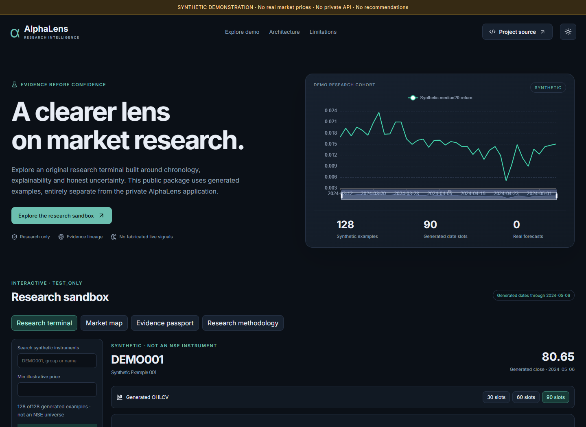

# AlphaLens

Local NSE market research with preserved historical evidence, interactive charts,
research diagnostics and an independent synthetic public demonstration.

## Current private application

Run `scripts\windows\start-p33-alphalens.cmd` from this directory and open
<http://127.0.0.1:8017>. Stop with `scripts\windows\stop-p33-alphalens.cmd`.
Use the existing operator account; credentials and records stay in protected local storage.

- `/nse-market`: saved current ordinary-equity universe, measured historical/technical/ML coverage, expanded experimental research and selected-stock chart links.
- `/analysis`: authenticated Upstox observations, truthful one-second delayed/indicative display, interactive candles/volume/indicators and separate frozen archive.
- `/experimental-ai-v2`: preserved original V2 experiment, prospective lifecycle and independent acceptance evidence.
- `/my-portfolio`, `/watchlists`, `/preferences`, `/decision-desk`, `/research-alerts`, `/journal`: manual FIFO accounting and descriptive personal research.

Current-master membership is not historical membership or data coverage. Expanded
research scores use the unchanged V2 model and are unvalidated extrapolation.
**NO_DEMONSTRATED_EDGE; independently accepted ML rankings remain unavailable.**
The original RELIANCE task remains separate. Expanded recurring collection requires
explicit approval of the exact configured scope, cadence and request/storage budget.

See the [operator runbook](docs/operator/alphalens-runbook.md),
[master market intelligence evidence](docs/development/alphalens-master-market-intelligence-report.md),
[source/classification audit](docs/data/full-nse-source-and-universe-audit.md) and
[cleanup inventory](docs/development/alphalens-cleanup-inventory.md).

The latest dated master separately contains 9,832 NSE cash identities, 2,706
type-EQ identities and 3,198 positively classified ordinary equities across
supported series. The controlled historical cohort is 500; complete NSE history,
experimental eligibility and source accessibility are measured separately.
The independent sequence benchmark uses a predeclared 100-stock study and preserves
all original V1/V2 model results. Its historical comparisons are development
evidence, with prospective acceptance still requiring genuine future observations.
Current expanded V2 inference genuinely scores 300 stocks and freezes 300 separate
research forecasts; the original 31 V2 forecasts remain unchanged. The registered
LSTM study trained successfully and supplies 43 current experimental scores, with
no LSTM prospective forecasts. Its 51.1185% development balanced accuracy does not
establish a predictive edge: uncertainty includes zero and assumed-cost net
reference returns were negative. These overlapping model cohorts are not 343 unique stocks.
See the [registered sequence protocol](docs/development/ml-sequence-v1-registered-protocol.md)
and [five-reference audit](docs/development/alphalens-reference-project-audit.md).

| Location | Responsibility |
|---|---|
| `apps/api/src/alphalens_api` | Authenticated loopback API and source contracts |
| `apps/web` | Compiled private dashboard and isolated synthetic demo |
| `workers/providers` | Vendor transports, positive identities, transient quotes, independent clocks |
| `workers/nse_market` | Explicit bounded cohort capture, coverage, pinned inference and daily orchestration |
| `workers/experimental_nse*` | Preserved separately versioned experiments, features, model evaluation, forward evidence |
| `portfolio`, `workers/personal`, `decision` | Exact accounting, personal workspace and descriptive research |
| `db`, `workers/daily`, `workers/alerts` | Schema ownership, original daily lifecycle and durable alerts |
| `scripts/windows`, `tests`, `docs` | Shared Windows entrypoints, verification and evidence |
| `.local-data` (ignored/private) | Operational observations, models, forecasts, backups and owned PostgreSQL; never publish |

## Historical P30 integration

[Explore the synthetic public demo](https://bhavi123-hacker.github.io/AlphaLens/)
(deployment and actual desktop/mobile verification passed). The demo is standalone,
uses explicitly synthetic prices and rankings, and connects to no private backend.

The private app adds securely imported Upstox credentials and genuinely verified
NSE RELIANCE daily candles. Manual provider charts and a one-instrument watchlist
remain separate from the frozen historical archive. Prices are transient; unknown
adjustment/action/calendar/publication facts and missing peer features stay visible.
Current predictions and Top5/10/20 rankings remain unavailable until independent
source/model/policy evidence clears them. Automatic retained updates are disabled.

See [source/rights decision](docs/data/p30-upstox-source-decision.md),
[resumable verification](docs/development/p30-final-integration-progress.md),
and the final P30 report/runbook when delivered. Earlier checkpoint descriptions
below are historical and do not override current verified provider access.



## Historical visual terminal (P26)

New local pages: Market Map (`/heatmap`), Advanced Screener (`/screener`),
Stock Comparison (`/compare`), expanded stock/ML/backtest/account analytics and
provider readiness in Settings. Search now prioritizes RELIANCE's canonical ISIN
ending 2026-10-06, rather than merging obsolete 2010 provisional identities.
Every graph remains historical/research-only. No live prices, signals or forecasts.

[Visual terminal guide](docs/dashboard/p26-visual-terminal.md) and
[Alpha Vantage credential/NSE decision](docs/data/alpha-vantage-provider-decision.md).

## Historical original-goal completion checkpoint (D78)

The P22-P25 local platform is preserved and verified. Automatic daily NSE research
is still **BLOCKED**: no cleared new-session source, accepted fresh model/peer/action
inputs or current ranking evidence. TejHQ's keyless status is technically reachable;
permission and raw-session coverage are separate gates. No new prices, predictions,
Top 5/10/20 lists or performance results were fabricated.

This continuation adds explicit source status/model compatibility inspection,
private immutable prospective records and exact offline horizon outcomes, durable
P20 evaluation events, authenticated forecast/readiness reads, visible dashboard
blockers, monitoring and safe backup integration. Real forecasts/outcomes remain0;
scheduling and outbound channels remain disabled. Historical research is unchanged.

Use [final Windows startup/account/stop/backup commands](docs/operations/final-windows-commands.md),
[provider decision](docs/data/final-daily-provider-decision.md),
[actual model checks](docs/ml/final-model-compatibility.json),
[complete acceptance/results](docs/development/final-completion-report.md) and
[resumable progress](docs/development/alphalens-final-completion-progress.md).
Existing platform acceptance is not proof of the original daily-research MVP,
profitable models, permitted production data or public security readiness.

## Historical milestone: P22-P25 local platform

AlphaLens now has authenticated component monitoring, bounded real request metrics,
redacted rotating logs, a durable P20 operations outbox, safe SQLite backup/isolated
restore, measured chart-loading improvements and one-process native Windows local
deployment. Historical research and financial decisions remain governed by their
original evidence contracts; no training, backtesting or holdout evaluation reruns.

Start with [Windows setup/start/stop/recovery](docs/operations/p24-windows-local-deployment.md),
[monitoring](docs/operations/p22-monitoring-recovery.md),
[measured performance](docs/development/p23-performance-report.md),
[current API](docs/api/p25-local-platform.md),
[final verification](docs/development/p25-verification-report.md) and
[remaining security findings](docs/development/p25-security-review.md).
Phase gates and exact executed results are in the final report and
[resumable checkpoint](docs/development/p22-p25-progress.md).

**P22, P23, P24 and P25 development acceptance PASSED.** Actual Linux/PostgreSQL
CI: 780 passed/eight skips; Windows 774 passed/11 skips plus documented corrections;
frontend59 and 17 distinct deployed browser scenarios passed across recorded runs.
Native image/auth/recovery checks passed. Strict container CI remains **FAILED:
44 HIGH/eight CVEs/zero CRITICAL**. See [exact CI receipt](docs/development/p25-ci-security-status.json).

Local application readiness does not clear live NSE acquisition, current stock
signals, full-path economic uncertainty or public production deployment. P19 remains
BLOCKED; production data OPEN/NOT_CLEARED; container/security production gates
remain blocked. No scheduler, outbound channel or real trading is activated.
Stop after P25. Earlier milestones below are historical acceptance records.

## Historical milestone: P21 local authentication

AlphaLens now requires a genuine local operator session for research, portfolio,
paper-account and alert APIs. Secure bootstrap, Argon2id, revocable opaque sessions,
CSRF-protected local account/notification controls and React login preserve the
existing research dashboard. This is a single-operator workspace, not multi-owner
isolation or production HTTPS. P19 daily activation remains blocked; no current
stock recommendation, outbound delivery or scheduling is enabled.

See [authentication and security boundaries](docs/security/p21-authentication.md),
[Windows account/startup commands](docs/security/p21-windows-commands.md),
[verification](docs/development/p21-verification-report.md) and
[container CVE review](docs/development/p21-container-security-review.md).
STOP after P21. Earlier phase reports below describe their historical checkpoints.

**P21_DEVELOPMENT_PASSED.** Actual Linux/PostgreSQL CI: 749 passed / eight skips;
frontend CI and container runtime checks passed. Strict container security remains
**FAILED: 44 HIGH / zero CRITICAL**; production readiness is blocked. See
[GitHub delivery and operator handoff](docs/development/p21-github-delivery.md).

## Historical milestone: P19/P20 local research alerts

P19 offline development is preserved; daily real-data activation remains blocked.
P20 adds durable operational notifications, an in-app center and local controls.
No current stock recommendations, outbound delivery or scheduling is enabled.
See the [combined verification report](docs/development/p19-p20-verification-report.md),
[alert architecture](docs/alerts/p20-architecture.md),
[provider decision](docs/pipeline/p19-activation-review-2026-10-11.md) and
[verified Windows commands](docs/alerts/p20-windows-commands.md).
Historical phase sections below retain their original checkpoint context.

P19 incremental research development is complete under D74 on `p19-daily-research`
from P18 `5e02e5c`. **P19_DEVELOPMENT_PASSED; P19_LIVE_DATA_ACTIVATION = BLOCKED.**
The offline worker reuses existing ingestion/quality/features, persists immutable
receipts and supports recovery. The local dashboard/API show actual run status;
no current prices, forecasts or signals are fabricated. Scheduling is disabled.
See [verification and resume checkpoint](docs/development/p19-verification-report.md),
[provider assessment](docs/data/p19-provider-assessment.md),
[security review](docs/development/p19-security-review.md) and
[exact Windows startup, inspection and recovery commands](docs/pipeline/p19-windows-commands.md).
Frozen research and production/security restrictions remain unchanged. STOP after P19.
Earlier phase entries below are historical.

P18 local research dashboard is authorized under D73 on `p18-dashboard` from
approved P17 `4c768cf`. See [frontend architecture, route mapping and exact Windows
startup commands](docs/frontend/p18-dashboard.md). P18 DEVELOPMENT PASSED; see
[acceptance evidence](docs/development/p18-verification-report.md). P19 is not started; research, production and security gates remain unchanged.
Earlier dated phase status entries below are historical.

P17 DEVELOPMENT PASSED (D72): 595 passed / one expected live-production skip,
2263.64s, including the original 33 P17 cases and actual PostgreSQL 17 reads.
One later Uvicorn log-redaction case also passed (34 P17 cases total); final API
Ruff/format/mypy/Bandit passed. The full suite predates that logging-only change.
OpenAPI and loopback startup passed. Production remains blocked; strict Trivy
retains 44 HIGH OS findings, no waiver. Research artifacts/protocol are unchanged.
See docs/development/p17-verification-report.md. STOP after P17; P18 not started.
Earlier phase status entries below are historical.

P17 local research read API is authorized under D72 on `p17-research-api`.
See [API contract, endpoint matrix and Windows CMD setup](docs/api/p17-research-api.md).
Development verification is recorded separately from blocked production readiness.
No current real opportunities/signals or unresolved strategy returns are invented.
All research fits, holdout results and hashes remain unchanged; P18/P19 are deferred.

Completed real research evidence: [all model/horizon metrics](docs/ml/real-model-metrics-tables.md), [walk-forward report](docs/ml/real-data-walk-forward-report.md), [hypothetical backtests](docs/backtesting/real-data-backtest-report.md), [verification and limitations](docs/development/d70-final-verification-report.md).

D70 real research replay COMPLETE: 152 model fits, 504 hypothetical backtests
and 46,072,188 OOS prediction records verified. Frozen dataset,
statistical configurations, folds and final-holdout boundaries are unchanged.
Completed accepted-run fits were reused after interruption; none was repeated.
The four development-locked candidates were evaluated once in 2026, without
retuning. All selected candidates remain REAL_RESEARCH_INSUFFICIENT_EVIDENCE.
Thirty backtests have available full-path raw-price diagnostics; 474 retain
unresolved economic outcomes. All twelve Logistic fits reached their fixed
iteration limit; convergence is not established. No profitability claim follows.

Required offline research software gates: 548 passed / one expected live skip,
1912.67s, Windows-safe suite and PostgreSQL 17 replay/teardown exit 0; frozen
lock/sync, Ruff, mypy, Bandit and Python dependency audit passed. These already
completed gates were reused under unchanged statistical code and lock.
The repaired TruffleHog scan passed on GitHub. The separate foundation-container
scan FAILED on reported OS/Rust findings; it is not waived and full CI success
is not claimed. See docs/development/ci-container-scan-status.json.

REAL_MARKET_OBSERVATIONS / RESEARCH_ONLY / FINAL_VINTAGE_RESEARCH_ASSUMPTION.
NOT PRODUCTION PIT. Production remains OPEN/NOT_CLEARED; fundamentals and
benchmark remain UNAVAILABLE. P11-P14 are unchanged. STOP before P17.
The following earlier running/pending checkpoints are historical and superseded.

Current D70 replay: real P4/P5 canonical and P6/P7 supervised datasets are frozen
under the separately authorized research methodology. 6,827,699 feature rows;
SMA100 availability 73.1147%, SMA200 55.4085% (including degraded context).
Chronological model training is running; OOS/backtest results remain pending.
No production clearance, P11-P14 calibration or P17 work. Earlier statuses below
are historical. See [training report](docs/ml/real-data-training-report.md).

Current D70 scope: proceed through P4-P10 under the separately versioned
RESEARCH_EOD_FINAL_VINTAGE_V1 research methodology. Missing historical evidence
is not declared solved. REAL_MARKET_OBSERVATIONS / RESEARCH_ONLY /
FINAL_VINTAGE_RESEARCH_ASSUMPTION must propagate. Normal verified PIT behavior
is unchanged. Preserve chronology, missing calendar/price slots, no future ISIN
backfill, no current-universe reconstruction or holdout tuning. Production remains
OPEN/NOT_CLEARED. STOP before P11-P14 calibration and P17. See
 docs/data/research-methodology-amendment.md. Earlier statuses follow historically.

Current scope D69: user authorizes pinned TejHQ NSE public Parquet for
NONCOMMERCIAL RESEARCH; proceed without additional permission clarification.
REAL_MARKET_OBSERVATIONS / RESEARCH_ONLY; production OPEN/NOT_CLEARED.
Preserve existing PIT/quality rules and unknown evidence. STOP before P17 and
P11-P14 recalibration. Historical audit conclusions below describe D68.

Pinned TejHQ acquisition/P2 normalization/P3 scoped validation COMPLETE: 35 native
originals checksum-verified; 7,225,761 normalized price rows, 5,288,138 VALID,
1,937,623 DEGRADED, zero rejected/quarantined. Current software verification:
506 passed/one production-live skip, PostgreSQL 17 replay/teardown exit 0; static
and dependency gates passed. P4-P10 real historical replay remains BLOCKED by
missing availability/completion/vintage clocks, an incomplete session calendar,
and dated identity/type evidence. No real model/performance claim or calibration.
See docs/data/real-10y-ingestion-report.md and docs/data/real-data-readiness.json.
The following D68 audit-only scope/status is historical and superseded by D69.

Current user-approved insertion (D68): real historical NSE research source audit
and, only after its hard rights/provenance gate passes, P2-P10 acquisition,
training and evaluation on real data. Branch real-data-10y-training from P16
3634b920e7e1d090b3fbf18af3548afb419e7b71. Audit currently BLOCKED; no new market
archive or real model training. STOP before P17. Production OPEN/NOT_CLEARED.

[Real-data ingestion report](docs/data/real-10y-ingestion-report.md) records
completed acquisition/P2/P3 and the historical evidence blocker. Source permission
is already authorized. The older access-request draft is superseded and unsent.
Software verification does not establish real-data training or performance.

P15 AND P16 DEVELOPMENT PASSED. P15 was committed as 2db5f15 before P16
implementation. Final P16 Windows-safe regression: 495 passed, one production/live
skip (1473.38s), including 35 P16 cases. PostgreSQL 17 ingestion, immutable replay,
restart recovery and teardown exited 0. Frozen lock/sync, Ruff, mypy, Bandit,
dependency audit and diff checks passed. STOP before P17; no production clearance.

P15 DEVELOPMENT PASSED: coherent Windows-safe 460 passed/one live skip (1128.68s),
37 P15 cases, PostgreSQL 17 replay/teardown exit 0 and all static/security/dependency
gates passed. 20 TEST_ONLY valuations/19 owned-security observations replay twice
with CLI/API equality. Commit P15 before P16 implementation. No production clearance.

Current authorization: **P15 Portfolio Guardian → verify/commit → P16 forward
paper simulation → verify/commit → STOP before P17**, from approved P14 5eaeb01
on `p15-p16-portfolio-paper` (D65-D67). No broker/API/frontend/live work.
[P15 accounting contract](docs/portfolio/p15-portfolio-guardian.md) defines exact
FIFO, cutoff valuations and honest chart-ready histories. All fixture values are
TEST_ONLY — NOT A REAL MARKET VALUATION / NOT A PERFORMANCE CLAIM.

# AlphaLens

AI-powered stock research and Portfolio Guardian decision support. AlphaLens never
places real trades. Initial product scope is NSE cash equities, INR, end-of-day V1.

## Historical P13/P14 milestone

Current authorization is **P13 then P14**, under D62-D64 from P12 `28070df`, on
`p13-p14-signals-explainability`. Verify/commit P13 before implementing P14;
verify/commit P14 separately, then STOP before P15. [P13 decision states](docs/decision/p13-signal-engine.md)
keep market and explicit synthetic-position contexts separate. Insufficient model
evidence blocks normal entry; full lifecycle demonstrations are TEST_ONLY only.
All thresholds and P12 weights remain DEVELOPMENT_ASSUMPTION, not genuine NSE
calibration. No portfolio, paper trading, API/frontend or live-data work.

P13 DEVELOPMENT PASSED: 394 passed/one live skip in the full Windows-safe suite;
PostgreSQL 17/replay/teardown and all static/security/dependency gates passed.
100 immutable TEST_ONLY signals replayed exactly. See [P13 verification](docs/development/p13-verification-report.md).
P13's separate commit must precede P14 code. No production signal calibration or
market-data clearance follows from this software acceptance.

P13 was committed as `490de2e` before [P14 offline explainability](docs/decision/p14-explainability.md)
began. P14 supplies deterministic summary, evidence and lineage cards, actual
feature values, checked local linear/native boosted-tree attribution, an explicit
sklearn-tree fallback, complete risk/ranking decomposition and price-free chart
annotations. Missing fundamentals/news/benchmark/action/live evidence remains
explicit. No new external package or paid LLM. [P14 verification](docs/development/p14-verification-report.md)
records P14 DEVELOPMENT PASSED: 423 passed/one live skip (1309.52s), PostgreSQL 17/
CLI replay/teardown exit 0 and all static/security/dependency gates. 100 explanations/
annotations and 128 actual selected P9 local linear attributions replay identically.
Separate P14 commit, then STOP before P15. User approval is required for P15 scope;
production market-data use remains NOT_CLEARED.

The following P11/P12 milestone is preserved as the approved baseline.

D59-D61 now authorize P11 risk, then P12 opportunity ranking from approved P10
`f709839`, on `p11-p12-risk-ranking`. Verify and commit P11 before P12 starts;
verify and commit P12 separately, then stop before P13. No signals, portfolio,
frontend or live recommendations. P11 DEVELOPMENT PASSED: 355 passed/one live
skip in one complete Windows-safe PostgreSQL run; all static/security gates and
current incremental Linux image passed. See [P11 risk](docs/decision/p11-risk-engine.md)
and [verification](docs/development/p11-verification-report.md). P11 was committed
as `b50314b` before P12 began. [P12 ranking](docs/decision/p12-opportunity-ranking.md)
DEVELOPMENT PASSED: fixed per-horizon candidates, explicit
risk penalties, retained exclusions and past-only rank history. No market winner
or live recommendation is established. Final coherent suite: 375 passed/one live
skip, PostgreSQL 17/CLI replay/teardown exit 0 and all quality/security gates passed.
See [P12 verification](docs/development/p12-verification-report.md), including the
corrected future-only exclusion leak and full rerun. Stop before P13.

The following P9/P10 checkpoint is preserved as the approved baseline.

P9 walk-forward evaluation and P10 backtesting are explicitly authorized in strict
order under D55-D58 from approved P8 58159b7, on p9-p10-evaluation-backtesting.
[P9 architecture](docs/ml/p9-walk-forward-evaluation.md) uses cutoff-specific P7
training snapshots, expanding disjoint tests, six model families per task, naive
comparators and genuine OOS predictions. P9 passed and was committed as `4e29b49`
before P10 began. [P10 architecture](docs/backtesting/p10-backtesting.md) consumes
only those OOS records for fixed hypothetical selection, exact cash/inventory,
next-session open fills, horizon exits and explicit cost scenarios. Missing exits
retain unresolved holdings. [Real-data readiness](docs/development/real-data-readiness.md)
records the remaining rights, universe, price, action, calendar and benchmark gaps.
TEST_ONLY — NOT A PERFORMANCE CLAIM. Production clearance is OPEN and production
market-data use is NOT_CLEARED. P10 DEVELOPMENT PASSED: 26 P10 cases and all
337 distinct repository tests passed across the final regression and targeted
Windows path retry; one live gate skip. See the [verification report](docs/development/p10-verification-report.md)
for exact runs and limitations. P11 onward requires separate approval.

The following records the approved historical P2-P7 milestones.

P0, the bounded P1 research fixture, and P2 raw-ingestion development are implemented.
P3/P4 are explicitly authorized sequential development under D43-D45 on
`p3-p4-validation-universe`. [P3 validation](docs/data/p3-data-validation.md)
passed and was committed before [P4 historical-universe development](docs/data/p4-point-in-time-universe.md).
Development fixtures do not establish real NSE PIT coverage.
**P3 DEVELOPMENT PASSED; P4 DEVELOPMENT PASSED.** Final verification:
[169 passed / one production-provider skip](docs/development/p4-verification-report.md).
P5 is now authorized under D46-D48 on `p5-canonical-data-model` from approved P4.
The [canonical model](docs/data/p5-canonical-data-model.md) integrates P2/P3/P4,
immutable PostgreSQL revisions/lineage, PIT reads and deterministic JSON/Parquet
snapshots. [P5 verification](docs/development/p5-verification-report.md) records the
current gate. D49-D50 now authorize P6/P7 sequentially from approved P5 649340a
on `p6-p7-features-labels`. P6 gates and commit preceded P7.
**P5 DEVELOPMENT PASSED:** 200 tests passed, one production/live-provider gate
skipped; real PostgreSQL and all static/security checks passed. This is ready for
subsequent authorized P6/P7 development, with production clearance still OPEN.
P0's contract is recorded in [DECISIONS.md](DECISIONS.md) and
[product contract](docs/product/product-contract.md). The DOCX remains the original
authoritative specification; approved amendments are recorded separately.

**P1 DEVELOPMENT:** a local CC BY research fixture is validated; production/live
data clearance remains OPEN. Five Mendeley datasets provide 300 bounded source rows,
299 canonical records and one explicit unavailable observation. This is not a
historical market universe or evidence of unbiased/PIT-safe performance.
AlphaLens requires ZERO paid dependencies. The mandatory path runs locally on
free/open-source software with compatible free data; cloud is optional.
See the [free-data strategy](docs/data/free-data-strategy.md). Earlier paid-provider
research is retained as evidence, not approval. Missing data is never fabricated.
The API contains only liveness/readiness endpoints. P6 supplies developer-only
[versioned technical features](docs/ml/p6-feature-engineering.md) from P5 snapshots.
P8 now supplies developer-only models; all product decision/UI phases remain deferred.
**P6 DEVELOPMENT PASSED:** 234 tests passed, one production/live-provider skip;
[P6 gate](docs/development/p6-verification-report.md). P7 follows the P6 commit.
P6 is committed as `ac6973f`. [P7 raw labels](docs/ml/p7-label-generation.md)
and explicit dataset alignment live in ml/labels, separate from ml/features and
ml/training package. P7 itself produces no models or investment results.
**P7 DEVELOPMENT PASSED:** 259 tests passed, one production/live-provider skip;
[P7 gate](docs/development/p7-verification-report.md) and
[TEST_ONLY descriptive outcome report](docs/development/p7-target-distribution.TEST_ONLY.json).
Both phases are complete; subsequent explicit user authorization permits P8 only.

See [local setup](docs/development/local-setup.md),
[research fixture and replay](docs/data/research-fixture-source.md),
[acceptance status](docs/product/roadmap-and-acceptance.md), and
[validation report](docs/data/p1-validation-report.md).

## Architecture

Modular monolith plus background workers when authorized. PostgreSQL is the
production structured store; object storage/Parquet retain versioned datasets and
artifacts; Redis is temporary cache/coordination, introduced when needed.
Provider parsing belongs behind vendor adapters. Backend owns authoritative
calculations and authorization. Data correctness precedes UI.

Prefer a per-date reconstructible NSE universe with verified historical identity,
availability and departed-security evidence. Historical NIFTY 500 is OPTIONAL for
V1; today's constituent list is never historical membership. Disclose actual legally
usable free history per dataset. PIT fundamentals remain UNAVAILABLE unless proven.

## Development verification

With a verified `uv` installation and generated lockfile:

```powershell
uv sync --frozen
uv run --frozen pytest
uv run --frozen ruff check .
uv run --frozen ruff format --check .
uv run --frozen mypy
```

Do not claim these checks passed unless they actually ran. The implementation
environment's results and blockers are recorded in the development report.
P1_PRODUCTION_DATA_CLEARANCE = OPEN. P2 development proceeds independently under
D40-D42. See [P2 architecture and commands](docs/data/p2-raw-ingestion.md) and
[verification](docs/development/p2-verification-report.md). D43-D45 supersede the
historical stop-before-P3 restriction; production clearance remains OPEN.

## P9/P10 authorized development — 2026-10-06

P9/P10 are explicitly authorized sequentially under D55-D58 from approved P8
58159b7 on p9-p10-evaluation-backtesting. P9 gates/commit precede all P10 code.
The [walk-forward contract](docs/ml/p9-walk-forward-evaluation.md) preserves
cutoff-specific P7 training snapshots, fresh expanding folds and genuine OOS output.
TEST_ONLY — NOT A PERFORMANCE CLAIM. Stop before P11; production gates remain open.

P9 DEVELOPMENT PASSED: 311 passed / one production-live skip; frozen lock,
static/security/dependency gates, real PostgreSQL 17/replay/teardown and Linux CPU
image/import checks pass. Eight TEST_ONLY task/horizon arenas replay 960 genuine
OOS predictions deterministically. [Verification](docs/development/p9-verification-report.md).
P10 begins only after the P9 commit. No production or real market-value claim.
P15 is committed as `2db5f15`; P16 forward paper simulation is undergoing its
separate complete gate. [P16 contract](docs/portfolio/p16-paper-trading.md) defines
manual default, explicit signal policy, reserved paper cash, future evidenced
next-open fills, P15 accounting and immutable event recovery. No broker or real
execution. TEST_ONLY PAPER SIMULATION — NOT REAL MARKET PERFORMANCE.

Read-only multi-provider preparation: [P28 comparison](docs/data/p28-provider-comparison.md), [architecture](docs/pipeline/p28-provider-architecture.md), [Windows commands](docs/pipeline/p28-windows-commands.md), [verification](docs/development/p28-verification-report.md). Upstox remains under review; collection/inference/scheduling are disabled.

## P29 research intelligence and independent demonstration

New authenticated Evidence Passport, exact shortlist-blocker diagnostics,
descriptive archival regime/coverage timeline, Model Reliability Matrix and
empirical drift/cohort stability views. No retraining or current recommendation.
Separate original synthetic static landing/research demo is prepared, not published.
See [research methods](docs/research/p29-intelligence-methods.md),
[API](docs/api/p29-research-intelligence.md),
[public demo](docs/operations/p29-public-demo.md),
[PostgreSQL operator setup](docs/operations/p29-postgresql-readiness.md),
[performance](docs/development/p29-performance-report.md) and
[resumable progress](docs/development/p29-research-intelligence-progress.md).
Live NSE/source/model/production gates remain blocked; financial tables are never
filled with fictitious holdings. P26 original checkout is preserved.

P29 [verified delivery and acceptance](docs/development/p29-verification-report.md),
[exact local Windows commands](docs/operations/p29-windows-commands.md),
[actual CI/security receipt](docs/development/p29-ci-security-status.json) and
[full preservation receipt](docs/development/p29-artifact-preservation.json).

## Investment evidence workspace

The existing `/nse-market` workspace now explains selection evidence, matches saved
research preferences, compares original gross/net results with four registered
lower-frequency policies, and links stock-level historical predictions to observed
returns. Five-session model scores remain separate from descriptive ten/twenty-session
views. Explicit budget/loss/cost inputs produce hypothetical 5/10/20% adverse-move
scenarios without changing transactions. No strategy has demonstrated an independent
profitable edge.

The operator explicitly approved the fixed 500-stock 20:30/21:30/22:30 IST collection
policy, limited to 250 stocks and 600 reserved GETs/run, 1,800/day with 60-minute cooldown.
The separate task is registered; first-run recovery and actual publication status
are detailed in [the investment evidence report](docs/development/alphalens-investment-evidence-completion-report.md).
RELIANCE remains separate. Registration does not prove complete daily coverage.
See [the operator runbook](docs/operator/alphalens-runbook.md) for operations.
