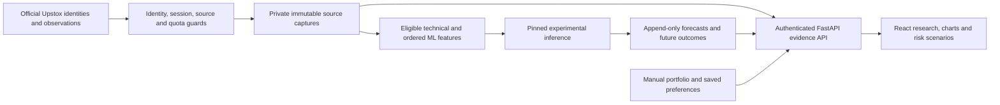

# AlphaLens: evidence-driven NSE research

AlphaLens helps a private user investigate securities, understand why they appear
in a research shortlist, compare model evidence with simple alternatives, and
examine possible losses alongside a manually recorded portfolio. It does not
execute orders or claim that an experimental score is a probability of profit.

## Delivered system

React 19 / TypeScript / TanStack Query / ECharts form the authenticated browser
application. FastAPI separates presentation contracts from Python data, feature,
model and research workers. PostgreSQL supports the original exact financial
ledger; private SQLite stores support authentication, personal records and
append-only experimental forecasts. Windows Credential Manager holds secrets.
Argon2id, opaque sessions, CSRF/origin checks and loopback deployment protect the
private application. Models are pinned, reviewed local artifacts; pages never
retrain models.

The dated 18 October 2026 snapshot has **3,198 current common-equity identities**,
**500** securities with **447,483 qualified daily candles**, **300** expanded V2
scores and **43** compatible current LSTM scores. Discovery, retained history and
model eligibility are distinct. History spans January 2022–16 October 2026; one
security lacks the latest cohort session. Current membership does not establish
a survivorship-free historical universe. Source bodies remain private.

## Quantitative research, including failure evidence

The registered sequence study uses 20-session windows with eight compatible
price-state inputs, a compact one-layer LSTM, training-only scaling, target
purging and embargo. Training: 31,665 pairs (2022–2023); validation: 18,693 pairs
(2024); historical development report: 27,820 pairs across 97 securities,
29 January 2025–9 October 2026. Shared-date comparisons use matching eligible
observations. These already inspected years are not a new independent holdout.

| Sequence experiment | Balanced accuracy | Top 5 net reference return |
|---|---:|---:|
| LSTM | 51.1185% | −44.9781% |
| Random forest | 52.0173% | See saved comparison |
| Histogram boosting | 52.1404% | See saved comparison |
| XGBoost | 52.1928% | −31.7746% |
| Mean reversion | 50.6571% | −25.6199% |

The target is a subsequent eligible open to fifth observed close **price-component
return**, not a same-day tradable close or dividend-inclusive shareholder return.
Reference simulations assume 50 bps round-trip costs plus 5 bps slippage each
side. They liquidate and re-enter every five sessions; unchanged membership does
not erase those costs. Endpoint drawdown does not measure every intraperiod loss.
No simulated execution is a broker fill or demonstrated investment profit.

The separate original V2 evaluation reports 50.1085% balanced accuracy versus
51.1131% mean reversion, using its own 16-feature contract, 50-stock cohort and
expanding folds. Its metrics cannot be pooled with the sequence study. Paired
whole-date block uncertainty includes zero for the relevant sequence improvement;
multiple-comparison risk remains. **NO_DEMONSTRATED_EDGE** is the retained finding.

## Operational engineering

The protected 500-stock task is approved for 20:30/21:30/22:30 IST, at most 250
stocks and 600 reserved GET attempts/run, 1,800/day, three attempts/day, 60-minute
cooldown and 31-day catch-up. A shared atomic limiter also covers quote/master
clients. Reservations survive crashes. Captures are immutable and replay skips
unchanged source requests. RELIANCE's separate 08:30 pilot remains preserved.
Task registration and HTTP 200 are not evidence of qualified candle delivery.
The first fresh-session collection is pending the real 19 October session and
provider publication. The UI reads saved operational evidence without polling
the provider or Windows Task Scheduler.

There are **31 original + 300 expanded frozen forecast bodies**, zero matured
outcomes and zero independently accepted rankings at this snapshot. Independent
acceptance requires the registered 126 matured decision dates, 1,000 outcomes,
30 securities, two quarters, statistical/economic/calibration/stability evidence
and a real independent reviewer. Software cannot compress those future sessions.

## Demonstration (five minutes)

1. Open `/nse-market`: search a company or ISIN, distinguish all current identities
   from the actual observed/scored cohort, and inspect a dated EOD reference.
2. Select five-session research, inspect a candidate's reasons, missing evidence,
   compatible LSTM score and portfolio context. Save its identity to a watchlist.
3. Open stock research: compare historical observed returns with Ridge return
   estimates and separately scaled classifier scores. No invented rupee target.
4. Compare matched sequence models/baselines, uncertainty and negative net results;
   inspect original V2 separately. Explain why accuracy alone is insufficient.
5. Enter explicit capital/loss/cost assumptions, inspect adverse-move scenarios,
   then show saved task status and zero matured prospective outcomes.

## Verification and limitations

The verified pre-product baseline passed 1,456 backend tests (eight skips), 108
frontend tests, six private compiled-browser cases, four synthetic-demo browser
cases and a strict container scan with zero HIGH/CRITICAL findings. Current product
and visual acceptance are recorded in the accompanying delivery report rather
than attributed to this older test run. Frozen archives (2,485 files), 47 original
alerts, models, credentials, personal records and forecasts are preserved by
hash/content checks. Three historical unverified secret-scanner fixture findings
remain disclosed; a clean changed-range scan does not erase them.

Remaining limits include incomplete action/dividend/vintage evidence, current-cohort
selection bias, unverified executable liquidity/capacity, limited historical
calendar completeness, uncertain quote chronology where explicitly labelled, and
unmatured future outcomes. Private source rights do not authorize public data
redistribution or regulated personalized investment advice.
