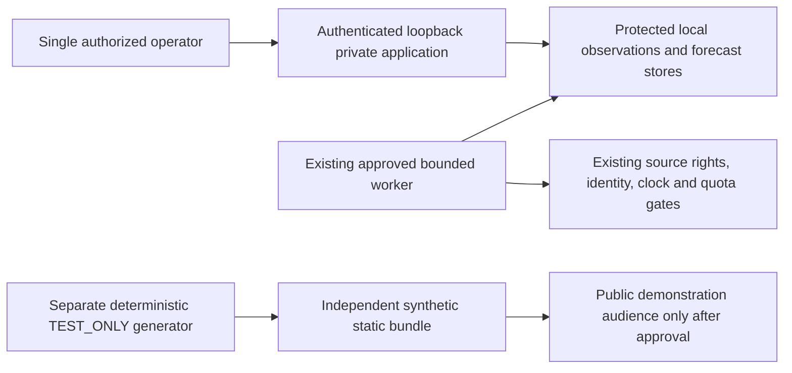

# Saved universe, capacity and source-rights readiness — 25 October 2026

This audit makes **zero provider or website requests**. It changes no task,
environment, deployed process, model, forecast, outcome or protected source record.
The private application remains the release owner's existing loopback deployment.

| Area | Status | Demonstrated scope |
| --- | --- | --- |
| Supported-equity detail contracts | VERIFIED_COMPLETE | Every one of the 3,207 positively supported saved identities has name/symbol/ISIN, a stock-detail contract, and genuine saved data or explicit missing-data reasons. |
| Measured saved price/model coverage | VERIFIED_COMPLETE | Counts and dates below come from verified saved publication/master evidence. This is not complete fresh whole-NSE coverage. |
| Full-universe daily acquisition | BLOCKED_APPROVAL | Existing 250/run, 600 reserved GETs/run, 1,800/day and three-run policy remains unchanged. |
| Guaranteed whole-market data/model coverage | BLOCKED_EXTERNAL_DATA | Listings, missing histories, publication, calendar/action evidence and usable features require genuine per-security observations. |
| Accepted recommendations | BLOCKED_MODEL_EVIDENCE | Existing compatible five-session scores remain experimental; no independent model acceptance follows. |
| Public real-data application | BLOCKED_EXTERNAL_DATA | Intended raw/derived redistribution and commercial permissions are absent. Publishing also requires explicit approval. |
| Public publishing action | BLOCKED_APPROVAL | Only the separately generated synthetic architecture is an available fallback; nothing was published here. |

## Current source-bound coverage

Read-only measurement: **2026-10-25T07:01:32.145913+00:00**.
Master captured **2026-10-24T15:57:55.726385+00:00**, snapshot
`0d724c77c487732917b1241bc60cfdfa4c61b3247a0d68d7b08907984d48b1cb`.
Pinned saved dataset:
`b4c7caadab62894fabf73648fa88de5f78814426c113f023613cb4a98f47a561`.

| Independent denominator | Measured result |
| --- | --- |
| Supported / searchable ordinary equities | **3,207 / 3,207** |
| Equities with saved prices and matching chart observations | **500** |
| Latest retained session | **23 October 2026** |
| Equities observed on that session | **498 / 500**, **99.6% retained-session coverage** |
| Missing that session | **2** |
| Complete compatible features for that session | **312** |
| Valid saved five-session predictions for that session | **312** |
| Original prediction generation | **2026-10-24T17:26:00.839348+00:00** |
| Calculable descriptive saved-price risk | **337**, each with its own observation date |
| Top 5 / 10 / 20 supported dated candidates | **5 / 10 / 20**, across all eligible saved predictions |
| Independently accepted ML predictions | **0** |
| Whole-universe securities without saved prices | **2,707** |
| Whole-universe securities without compatible saved predictions | **2,895** |

Latest feature exclusions are 152 known-action lookback exclusions, 34 missing
lookback slots and two missing latest observations. Risk is unavailable for 2,707
without prices, 152 with known-action lookback exclusions and 11 with missing price
slots. Risk, feature and model counts have different requirements; they cannot be
added. A retained coverage fraction does not establish a daily job-success rate.
The independently maintained collection-health surface reports actual runs.

`workers/nse_market/operational_coverage.py` builds indexes once and checks all
supported identities without thousands of HTTP calls or raw-source replays. It
rejects incomplete identity, duplicated securities, a mismatched last chart/price,
future/invalid scores, wrong horizon/schema and nonfinite/incomplete vectors.
It uses the existing missing-history and risk logic. This is a saved software/data
contract audit; authentication and compiled-browser checks remain separate release
tests. It does not claim every security has a price, a model or a matured outcome.

Representative real saved cases are RELIANCE/HDFCBANK (23 October price/chart,
risk and saved model inputs), TCS (price/chart but known-action model/risk
exclusion), AGOL (price/chart with missing-lookback features), and AAKAAR
(supported identity with no saved prices/history). Historical and pending outcome
states remain in the original read-only forecast history; no empty history is
converted to a zero return. Authoritative sector/capitalization metadata remains
unavailable and was not invented.

Private per-security evidence:
`.local-data/operational-universe-20261025/saved-coverage-b4c7caadab62894fabf73648fa88de5f78814426c113f023613cb4a98f47a561.json`.

## Daily workload and historical bootstrap are distinct

The existing deterministic proposal remains available through
`python -m workers.nse_market.coverage_plan`. It prioritizes existing configured
pending securities, then evidence age and stable ISIN, without score selection.
It verifies target-specific saved candle/action checkpoints and calendar cache;
it neither collects nor grants an acquisition policy.

| Proposed workload | Arithmetic / boundary |
| --- | --- |
| Full 3,207-equity daily cycle | **13 batches** of at most 250 securities |
| Successful stock-request path | **3,207 candle + 3,207 action GETs = 6,414 GETs**, conditional on valid nonempty candles |
| Conservative metadata allowance | At most **71/run**, or **923** across 13 runs, for existing clock-independent calendar/master request bounds |
| Stock path plus that metadata ceiling | **7,337 GETs**; retries/publication failures still consume the unchanged reservations |
| Fully reserved capacity | **13 × 600 = 7,800 GETs**, versus **1,800/day** currently approved |
| Capacity days at three runs/day | At least **5**; rotating over five days is not full daily coverage |
| New-history bootstrap, 2,707 unobserved equities | At least **5,414 stock GETs** under a one-history/one-action successful path; exact date ranges, chunking and metadata remain a separate unapproved plan |

A target-session daily request yields one or a bounded catch-up set of observations.
It does not establish the required 61 complete compatible lookback slots. Historical
bootstrap must declare dates, source/version, per-security identity, calendar and
action checks, request ceilings, storage, retention and retry behavior first.
Some listings cannot supply that history. No model experiment or holdout rerun is
needed or authorized by this plan.

Saved completed calendars, same-session candles/actions, normalized checksum-bound
data and skipped already-observed slots can reduce work. Reuse is limited to the
existing verified cache rules: expired future-calendar facts need a new revision;
an earlier action response is not assumed reusable across arbitrary later sessions.
No provider-supported bulk endpoint, unmeasured caching speedup, additional
reservation, changed cooldown or free leftover-quota entitlement is assumed.

## Duration estimates from genuine receipts

Eight completed positive-GET receipts from 18–24 October are retained, including
empty/publication-pending runs and an explicitly interrupted run. Seven ordinary
completed jobs made 250–504 GETs in 116–1,578 seconds. Prorating their whole-job
time per actual GET to the **6,414-stock-GET** workload gives approximately:

- **0.68–5.63 active hours**, median **1.36 hours**, for those seven ordinary jobs.
- Across all eight receipts, the observed upper extrapolation is **70.59 hours**;
  the deliberately interrupted five-GET job is reported rather than hidden.

These are **workload estimates, not provider/network benchmarks, confidence
intervals, completion promises or speedup claims**. Clock checks, validation,
inference, persistence and failures are included in recorded job time. Additional
metadata, retries, mandated cooldown, overnight cadence, source publication and
the five-capacity-day constraint remain. A fresh authorized sustained run would
be required before a same-day expansion commitment.

## Storage measured from retained source payloads

Measurements use 498 completed latest-session security folders and 450 historical
normalization manifests. Source/checksum links and actual file sizes are read;
no source data, cache, archive or backup is deleted or rewritten.

| Source-based scenario | Size |
| --- | --- |
| Current immutable 500-security market projection | **9,772,736 bytes** |
| Full-universe projection, linear scaling assumption | **59.78 MiB per publication** |
| Full-universe daily retained source folders | **9.16–10.24 MiB**, median **9.73 MiB per session** |
| Full-universe 61-slot source bootstrap | **21.44–33.14 MiB**, median **24.22 MiB**, prorating observed data bytes plus fixed per-security evidence |
| Three projections plus median daily source | About **189.07 MiB/session** under that explicit publication assumption |
| Same scenario for 252 sessions | About **46.53 GiB**; 252 is a planning assumption, not an established exchange calendar |

Ranges are observed sample extrema/medians, not guaranteed storage bounds. Daily
folder sizes include retained attempts and normalization/checksum records.
Historical estimates do not guarantee history exists; short payloads, new listings,
corporate actions, provider formats and compression can change size. Forecast and
outcome databases, PostgreSQL, model artifacts, logs, backups and all frozen
research are additional. Current source totals separately measure 4,056,820 daily
evidence bytes, 38,076,229 history bytes and 33,984,123 immutable market-view bytes.
Repeated immutable projections can dominate growth. Any future compaction or
relocation needs a separate preservation/rollback policy and approval.

## Failure and permission matrix

| Condition | Required behavior / release consequence |
| --- | --- |
| Empty/pending provider publication | Retain genuine attempt and reason, bounded retry, no synthetic close or action-success assumption. |
| Missing observation or short listing history | Show incomplete chart/features and no eligible forecast; do not fill slots. |
| Action/identity/calendar ambiguity | Preserve exclusions, verify exact ISIN and dated source evidence; do not join by ticker or infer a delisting. |
| Expired master | Keep dated discovery; block current identity actions until qualified refresh. |
| Unqualified clock/session/special session | Fail closed under existing raw-clock rules; never widen timestamp tolerances. |
| Worker interruption or publication failure | Recover through existing verified checkpoints/idempotent stages; task exit alone proves no collection. |
| Exhausted reservation/rate-limit/cooldown | Stop within the unchanged policy; no automatic wider universe or extra slot. |
| Public/commercial rights absent | Keep the real-data application private; use only the independently synthetic static surface publicly. |

The saved rights review is [P34 private Upstox use](../data/p34-private-upstox-use-decision.md)
and the [experimental source audit](../data/experimental-nse-source-audit.md).
They record the official staff response in topic17302/post3 dated 1 September
2026 and read-only Analytics Token documentation. This task reviewed those saved
records and made no external revalidation or contact.

| Use | Status | Evidence / exact missing permission |
| --- | --- | --- |
| Existing bounded single-operator private noncommercial historical retention/ML | VERIFIED_COMPLETE | Existing project decision is supported by the specific staff interpretation, subject to applicable API terms, quotas and authorized scope. It is not an executed exchange licence or broader production clearance. |
| Existing authenticated personal local derived dashboard | VERIFIED_COMPLETE | Existing approved single-operator private-analysis scope; authentication does not authorize additional customers or third-party display. |
| Wider whole-master recurring private collection | BLOCKED_APPROVAL | Exact cohort, cadence, quota, storage and retention approval is absent; current source/account limits and applicable terms must support the proposed scope. |
| Third-party hosted private research service | BLOCKED_EXTERNAL_DATA | Account-specific agreement/version and permission for processing/storage at that host, users and purpose are not established. |
| Public raw quotes, historical charts, candles or downloadable NSE data | BLOCKED_EXTERNAL_DATA | Explicit Upstox/NSE/exchange redistribution/display rights for that audience, channel, refresh rate, retention, attribution and export are missing. |
| Public derived scores, models, signals or recommendations | BLOCKED_EXTERNAL_DATA | The saved private-use question excludes redistribution; an express derived-output/model/signal distribution grant is missing. |
| Commercial use / customers / adviser service | BLOCKED_EXTERNAL_DATA | Express commercial/product/user-scope rights and applicable independent financial/regulatory/model acceptance evidence are missing. |
| General contractual retention and termination assurance | BLOCKED_EXTERNAL_DATA | Applicable account clickwrap/agreement version, storage duration, deletion/revocation/token-termination obligations and downstream exchange conditions were not exhaustively issued in the saved reply. |

No message or licence request was sent. No permission is inferred from public
accessibility, API success, authentication or a model's numerical reproducibility.

## Private-first public architecture



The local Windows/CPU/PostgreSQL path remains free and private by default. There
is no public listener, tunnel, shared real-data API or broker execution path in
this proposal. The independent `apps/web/vite.demo.config.ts` already uses a
separate static entry, no API proxy, no public-directory copy, no private imports
and a `DEMO_PUBLIC_` environment prefix. The synthetic demo explicitly labels
generated identities, dates and prices and supplies no real ML performance.

A permitted synthetic release must build only that entry and generated allowlist,
retain licence notices, scan bundles for secrets/private artifacts and verify zero
private API dependencies before approval. It must not package private market
stores, tokens, sessions, accounts, forecasts, financial records or trained real
models. Public real-data hosting remains a separate gated design requiring the
missing grants, exact users/terms/costs, security, persistent storage, backup,
authentication/TLS and final user approval. No paid hosting is required or enabled.

## Reproduction

```powershell
.local-data/completion-runtime/venv/Scripts/python.exe -m workers.nse_market.operational_coverage --root .local-data/nse-market-expansion --universe-root .local-data/nse-universe
.local-data/completion-runtime/venv/Scripts/python.exe -m pytest tests/unit/test_nse_operational_coverage.py tests/unit/test_nse_discovery.py tests/unit/test_nse_coverage_plan.py -q
```

The CLI prints aggregate metadata only; the callable report can retain private
per-security contract evidence. **19 scoped tests passed in 3.42 seconds**; scoped Ruff and strict
mypy passed. These fixture tests are explicitly TEST_ONLY and cover all-3,207
contracts, duplicate/mismatched data, incompatible predictions, future/zero-GET/
unfinished timing exclusion and pinned-projection sizing without pointer races.
The derived private `workload-estimates-v1.json` receipt retains the exact source
report checksum and both duration groupings. Final whole-release CI, browser,
preservation and runtime evidence belong in the release owner's final report.
